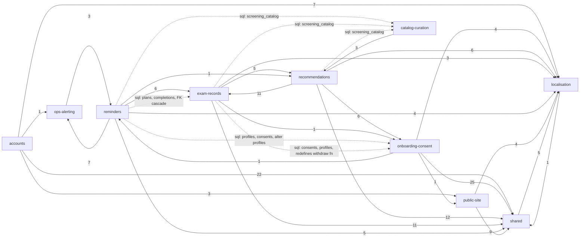

# Evidence: structure

Head 159e566. Tracked files only, noise from `.work/noise.txt` removed, tests excluded from the graph (kept separately for test risks). Attribution through `.work/attribute.mjs` + `.work/capabilities.tsv`: 0 of 109 graph files unmapped. Raw output: `context/map/.work/structure-*`, `edges-ts.csv`, `edges-ts-with-tests.csv`.

## Graph sources

| Layer                                                                          | Source                                                                                                                                                                                                                                                                                                     | Level         | Confidence                                                                                                                       | Blind spots                                                                                                                                                                                                                |
| ------------------------------------------------------------------------------ | ---------------------------------------------------------------------------------------------------------------------------------------------------------------------------------------------------------------------------------------------------------------------------------------------------------- | ------------- | -------------------------------------------------------------------------------------------------------------------------------- | -------------------------------------------------------------------------------------------------------------------------------------------------------------------------------------------------------------------------- |
| TS / TSX / .astro / .mjs (109 files, 340 edges: 292 runtime, 48 type, 0 build) | TypeScript 6.0.3 compiler API from `node_modules` (`.work/structure-edges.mjs`): AST walk of `import`/`export … from`/`import()`/`import("…")` types; `.astro` frontmatter + `<script>` blocks parsed as TS; `@/*` resolved per `tsconfig.json`; type-only = `import type` or every named specifier `type` | 2 (toolchain) | medium-high (cross-check: 332 single-line import statements found by rg vs 340 resolved edges; 1 unresolved spec = a CSS import) | Astro template-only usage (components referenced only via frontmatter imports are caught; slots/props are not edges); `astro:*` virtual modules and `cloudflare:*` treated as external; no dynamic imports exist (0 found) |
| Existing boundary rule                                                         | `eslint.config.js` `reminderClientConfig`: `no-restricted-imports` forbids `@/lib/reminders/*` from pages, components, layouts, middleware                                                                                                                                                                 | 1 (repo)      | evidence                                                                                                                         | Only one boundary is encoded; no rule for the others                                                                                                                                                                       |
| SQL (`supabase/migrations`, `supabase/tests`, 10 + 7 files)                    | No graph tool. Cheap rg: `.rpc("…")`/`.from("…")` call sites in TS (22 of 23 resolved, 1 dynamic `.from(table)` in `src/pages/api/screenings.ts:68`), `create table` owners, cross-capability table names per SQL file, `alter table`/FK `on delete cascade`/function redefinitions                        | 4 (fallback)  | low                                                                                                                              | Column-level use, views, triggers, RLS policy bodies, function bodies calling other functions: `unknown`                                                                                                                   |
| JSON catalog (`catalog/entries/*.json`)                                        | none                                                                                                                                                                                                                                                                                                       | —             | —                                                                                                                                | Consumed by `scripts/catalog` (generator) into a noise-filtered snapshot migration; read at runtime from table `screening_catalog`: `unknown` beyond that                                                                  |
| Platform config (`wrangler.jsonc`, `.github/workflows`)                        | none                                                                                                                                                                                                                                                                                                       | —             | —                                                                                                                                | 0 import edges from platform files; the worker entry (`wrangler.jsonc` main → `src/worker.ts`) and CI → scripts wiring are config, not imports: `unknown`                                                                  |

## Capability graph

Runtime import edges folded to capabilities, excluding `src/pages/dev/kitchen-sink.astro` (dev-only showcase, 404 in production; it alone adds `shared → accounts/exam-records/recommendations/onboarding-consent`, 13 edges). `graph-metrics.mjs --modules capabilities.tsv --kind runtime --exclude '^src/pages/dev/'` (evidence). Ca/Ce count distinct neighbouring capabilities; edge files = file-level import edges crossing out of / into the capability.

| Capability         | Graph files | Internal edges |  Ca |  Ce | Instability | In-edges (files) |      Out-edges (files) |
| ------------------ | ----------: | -------------: | --: | --: | ----------: | ---------------: | ---------------------: |
| shared             |          20 |             24 |   7 |   1 |        0.13 |               85 | 5 (all → localisation) |
| localisation       |           5 |              4 |   7 |   1 |        0.13 |               33 |                      1 |
| recommendations    |          12 |             15 |   3 |   4 |        0.57 |                9 |                     35 |
| exam-records       |          11 |             12 |   2 |   4 |        0.67 |               17 |                     20 |
| onboarding-consent |           9 |             10 |   2 |   4 |        0.67 |                7 |                     31 |
| reminders          |          16 |             25 |   2 |   5 |        0.71 |                4 |                     23 |
| ops-alerting       |           5 |              3 |   2 |   1 |        0.33 |                8 |                      3 |
| public-site        |           4 |              3 |   2 |   2 |        0.50 |                4 |                     13 |
| accounts           |          14 |             12 |   0 |   4 |        1.00 |                0 |                     33 |
| catalog-curation   |           6 |              6 |   0 |   1 |        1.00 |                0 |                      3 |
| platform           |           7 |              0 |   0 |   0 |           — |                0 |                      0 |

Solid = runtime imports (label = file-level edges); dashed = SQL coupling found by rg (table refs, FKs, `alter table`, function redefinition) — import graph does not see it.

## Blast radius per capability

High-criticality capabilities. "Contracts" = files of the capability imported at runtime from another capability (`.work/structure-contracts.tsv`, evidence).

| Capability         | Incoming (runtime, who depends on it)                                                                                                                          | Outgoing                                                                                                                          | Contracts others import                                                                                                                                                                                                                              | SQL reach (rg, low confidence)                                                                                                                                                                                                                                                                      |
| ------------------ | -------------------------------------------------------------------------------------------------------------------------------------------------------------- | --------------------------------------------------------------------------------------------------------------------------------- | ---------------------------------------------------------------------------------------------------------------------------------------------------------------------------------------------------------------------------------------------------- | --------------------------------------------------------------------------------------------------------------------------------------------------------------------------------------------------------------------------------------------------------------------------------------------------- |
| exam-records       | recommendations (11 edges), reminders (6)                                                                                                                      | shared 11, recommendations 5, l10n 3, onboarding 1                                                                                | `src/lib/screenings/rules.ts` (5 importers, recs + reminders), `screenings/format.ts` (3), `screenings/due.ts` (2, reminders); 5 components in `src/components/recommendations/` + `saved.ts` used by `RecommendationItem.astro` / `dashboard.astro` | owns `screening_plans`, `screening_completions`; reminders migrations reference them (plans 3–5×, completions 2–4×) and cascade-delete from them (`follow_up_nudges.sql:14`, `appointment_reminders.sql:54`, `due_screening_reminders.sql:34`) — schema change here reaches the cron pipeline       |
| recommendations    | exam-records (5), catalog-curation (3, tooling), reminders (1)                                                                                                 | shared 12, exam-records 11, onboarding 6, l10n 6                                                                                  | `src/lib/catalog/recommend.ts` (3, exam-records: `classifyEntries`, `resolveInterval`, `recommend`), `catalog/read.ts` (2, exam-records + reminders), `catalog/schema.ts` + `factors.ts` (catalog scripts), `TierBadge.astro` (PlanItem)             | reads `screening_catalog` (3 call sites)                                                                                                                                                                                                                                                            |
| onboarding-consent | recommendations (6), exam-records (1)                                                                                                                          | shared 25, l10n 4, public-site 1, reminders 1                                                                                     | `src/lib/profile.ts` (5 importers, all recommendations: `MAX_AGE`, `SEX_VALUES`, `SMOKING_STATUSES`, `Profile`), `src/lib/consent.ts` (2: `dashboard.astro`, `api/screenings.ts` → `getOnboardingState`)                                             | owns `profiles`, `health_data_consents`, fn `withdraw_health_data_consent`; the fn is redefined by exam-records' `20260930093108_screening_records.sql:194`; `profiles` altered by reminders' `20260930125726_appointment_reminders.sql:12`; referenced by every reminders migration and pgTAP test |
| reminders          | ops-alerting (3: `heartbeat.ts` → `email.ts`, `schedule.ts`; `failure-alert.ts` → `email.ts`), onboarding-consent (1: `profile.astro` → `RemindersForm.astro`) | ops-alerting 7, exam-records 6, shared 5, l10n 4, recs 1                                                                          | `src/lib/email.ts` (2), `src/lib/schedule.ts` (1), `RemindersForm.astro` (1)                                                                                                                                                                         | 8 RPCs (`claim_*`, `mark_*_sent`, `get_due_screening_candidates`) defined in its own 3 migrations; reaches into 3 other capabilities' tables                                                                                                                                                        |
| accounts           | none (pure entry layer: Ca 0)                                                                                                                                  | shared 22, l10n 7, public-site 3 (`PublicHeader.astro` on sign-in/up/confirm pages), ops 1 (`middleware.ts` → `observability.ts`) | none at runtime (only the dev page imports `password.ts`, `PasswordRules.tsx`, `PasswordToggle.tsx`)                                                                                                                                                 | Supabase auth only (no own tables)                                                                                                                                                                                                                                                                  |
| catalog-curation   | none (Ca 0)                                                                                                                                                    | recommendations 3 (`scripts/catalog/{lib,draft-core}.ts` → `catalog/schema.ts`, `draft.ts` → `catalog/factors.ts`)                | none                                                                                                                                                                                                                                                 | owns `screening_catalog`; referenced by exam-records and reminders migrations and by recommendations at runtime                                                                                                                                                                                     |
| platform           | no import edges either way                                                                                                                                     | —                                                                                                                                 | —                                                                                                                                                                                                                                                    | `unknown`: coupling is config (wrangler main, CI jobs, lint-staged globs)                                                                                                                                                                                                                           |

## Cycles

- **File level, runtime: 0 cycles** (100 nodes, 292 edges; `graph-metrics.mjs edges-ts.csv --kind runtime`). Evidence.
- **Capability level, runtime (excl. dev page): 2 SCCs**, which exist only after folding (no file loop behind them):
  - `exam-records ↔ recommendations` — smallest real capability loop. One direction: `src/lib/screenings/{rules,due}.ts` and `src/pages/api/screenings.ts` → `src/lib/catalog/recommend.ts` (+ `PlanItem.astro` → `TierBadge.astro`); other direction: `src/pages/dashboard.astro` and `RecommendationItem.astro` → `src/lib/screenings/*` and the exam-record components. Inference: the interval/tier rules live in `catalog/recommend.ts` but the recurrence engine in `screenings/` builds on them, while the dashboard composes both.
  - `reminders ↔ ops-alerting` — `src/worker.ts` → `heartbeat.ts`/`failure-alert.ts`/`observability.ts`; `heartbeat.ts`/`failure-alert.ts` → `src/lib/email.ts`, `src/lib/schedule.ts`. Inference: `email.ts`/`schedule.ts` are email infrastructure shared by both, not reminder logic.
  - The 5-node SCC graph-metrics reports (exam-records, onboarding-consent, ops-alerting, recommendations, reminders) is these two loops joined by one-way chains (`onboarding-consent → reminders` via `profile.astro` → `RemindersForm.astro`; `reminders → exam-records`; `recommendations → onboarding-consent`).
  - `localisation ↔ shared` (2 nodes): `Layout.astro`, `AppHeader.astro`, `src/lib/errors.ts` → `src/i18n/index.ts`; back via `src/pages/api/locale.ts` → `src/lib/forms.ts` (1 edge). Mechanical: an endpoint filed under localisation uses the shared form helper.
- Including the dev page the whole graph collapses into one 9-node SCC — artefact of `kitchen-sink.astro` (dev only), see Mechanical signals.

## Broken boundaries

Intended layering (inference from CLAUDE.md and folder names): `shared` + `localisation` (foundation) → `src/lib/*` feature logic → `src/components/*` → `src/pages/**` / `src/worker.ts` (entry points); `src/lib/reminders` cron-only.

| Edge (runtime)                                                                                                                                                                                              | Against which layer rule                                                                                                       | Label                        |
| ----------------------------------------------------------------------------------------------------------------------------------------------------------------------------------------------------------- | ------------------------------------------------------------------------------------------------------------------------------ | ---------------------------- |
| Pages/components/layouts/middleware → `src/lib/reminders/*`: **0 edges**; only `src/worker.ts` imports it                                                                                                   | the one encoded rule (ESLint) holds                                                                                            | evidence                     |
| `exam-records` components (`PlanItem`, `DoneItem`, `ScreeningActions`, `SavedNote`, `saved.ts`) live in `src/components/recommendations/` and import / are imported by recommendations components (6 edges) | folder boundary ≠ capability boundary: one folder, two capabilities                                                            | evidence (paths) + inference |
| `src/lib/screenings/rules.ts`, `due.ts` → `src/lib/catalog/recommend.ts` (runtime: `classifyEntries`, `resolveInterval`)                                                                                    | feature → feature at the logic layer; makes the exam-records ↔ recommendations loop                                            | evidence                     |
| `src/lib/catalog/{schema,factors,rule-entry,wording}.ts` → `src/lib/profile.ts` (constants and `Profile` type)                                                                                              | recommendations' rule engine depends on onboarding-consent's profile module; `profile.ts` acts as a domain-vocabulary contract | evidence + inference         |
| `src/lib/heartbeat.ts`, `failure-alert.ts` (ops-alerting) → `src/lib/email.ts`, `schedule.ts` (reminders)                                                                                                   | ops depends on the capability it monitors (`email.ts` is infra-shaped)                                                         | inference                    |
| `src/pages/{auth/*,onboarding}.astro` → `src/components/PublicHeader.astro` (public-site, 4 edges)                                                                                                          | header used by authenticated-adjacent pages is filed under public-site; behaves as `shared`                                    | inference                    |
| `src/pages/api/screenings.ts` imports 5 capabilities (exam-records, recommendations, onboarding-consent, l10n, shared)                                                                                      | fattest endpoint; recomputes recommendations + consent state server-side                                                       | evidence                     |
| SQL: exam-records migration redefines onboarding-consent's `withdraw_health_data_consent()`; reminders migration `alter table public.profiles`                                                              | schema ownership crosses capabilities; invisible to imports and to lint                                                        | evidence (rg)                |

## Test risks

Unit tests: 14 files, 36 test→source edges (`.work/structure-test-edges.txt`). Per capability: exam-records 5, reminders 5, recommendations 3, ops-alerting 1; **accounts, onboarding-consent, localisation, shared, public-site, catalog-curation: 0** (catalog-curation is guarded by `npm run catalog:check` instead). No unit test imports `@/lib/supabase` or `admin-client`.

| Capability         | Why hard to isolate                                                                                                                                                                  | Fits                                                                                                                                                                   |
| ------------------ | ------------------------------------------------------------------------------------------------------------------------------------------------------------------------------------ | ---------------------------------------------------------------------------------------------------------------------------------------------------------------------- |
| reminders          | 4 job modules import `admin-client.ts` (service-role Supabase client); 8 RPCs + 3 other capabilities' tables; `astro:env/server` in 3 files; email provider                          | pure parts unit-tested (`candidates`, `chain`, `nudge-message`, `email`, `email-retry`); claim/mark flow → pgTAP (3 suites exist) + integration against local Supabase |
| exam-records       | `api/screenings.ts` pulls Supabase SSR client, catalog read, consent state, dynamic `.from(table)`                                                                                   | rules/due/format/flash unit-tested; endpoint → smoke/integration; RLS → pgTAP (2 suites)                                                                               |
| onboarding-consent | `profile.ts` (Ca 8, 0 colocated test), `consent.ts` (0 tests, imported by dashboard + screenings API); 5 files import `@/lib/supabase`; withdrawal is a SQL function redefined twice | consent/withdraw → pgTAP + smoke; `profile.ts` constants are pure and cheaply unit-testable                                                                            |
| accounts           | 5 files import `@/lib/supabase`; `middleware.ts`, `password.ts`, `auth-errors.ts` have 0 tests; Supabase auth is external                                                            | smoke (`scripts/smoke.mjs`) / e2e; `password.ts` + `auth-errors.ts` pure → unit                                                                                        |
| recommendations    | `catalog/read.ts` hits Supabase; rule engine pure (`recommend`, `rule-entry`, `wording` tested)                                                                                      | unit for engine; `dashboard.astro` (Ce 21) → e2e/screenshot                                                                                                            |
| ops-alerting       | `astro:env/server` in 3 files, email send                                                                                                                                            | unit with injected sender (observability tested); heartbeat/failure-alert untested                                                                                     |

## Centres and thin entry points

| Node (file level, runtime)                  |           Ca |  Ce | Instability | Reading                                                                                                                       |
| ------------------------------------------- | -----------: | --: | ----------: | ----------------------------------------------------------------------------------------------------------------------------- |
| `src/i18n/index.ts`                         |           34 |   2 |        0.06 | load-bearing, but config-as-code fan-in (string catalog, rule 2); type-checked → cheap coupling                               |
| `src/lib/supabase.ts`                       |           13 |   0 |           0 | load-bearing data-access contract for every request path (accounts, onboarding, exam-records, recs, reminders' form endpoint) |
| `src/components/ui/{button,card,alert}.tsx` | 12 / 11 / 10 |   1 |      ≤ 0.09 | shadcn primitives, design-system fan-in (rule 2)                                                                              |
| `src/lib/utils.ts`, `forms.ts`              |        12, 8 |   0 |           0 | shared helpers (`cn()`, `readForm()`)                                                                                         |
| `src/layouts/Layout.astro`                  |           10 |   2 |        0.17 | page shell                                                                                                                    |
| `src/lib/screenings/rules.ts`               |            9 |   1 |        0.10 | **business centre**: recurrence/due rules consumed by recommendations and reminders — highest-Ca business file                |
| `src/lib/profile.ts`                        |            8 |   0 |           0 | **business centre**: profile vocabulary for the rule engine                                                                   |
| `src/lib/observability.ts`                  |            8 |   0 |           0 | logging contract (middleware + every reminder job)                                                                            |

Entry points (Ca 0): `dashboard.astro` (Ce 21 — composition hub, not thin), `onboarding.astro` / `profile.astro` (11), `api/screenings.ts` (7, fat), `src/worker.ts` (7: cron dispatcher, delegates to 4 reminder jobs + 3 ops modules — thin), `api/auth/*` (callback, signout import only `shared` → thin, delegate to Supabase), `api/consent/withdraw.ts` and `api/reminders.ts` (only `shared` → thin; logic lives in SQL/RPC — inference: the core of withdrawal is the SQL function, not TS).

## Mechanical signals

| Signal                                                     |                                                                                                  Count | Why mechanical                                                                                             |
| ---------------------------------------------------------- | -----------------------------------------------------------------------------------------------------: | ---------------------------------------------------------------------------------------------------------- |
| `src/pages/dev/kitchen-sink.astro` fan-out                 |                                           Ce 22; 13 cross-cap edges incl. all `shared → feature` edges | dev-only page (404 in prod); collapses capability graph into one 9-node SCC; excluded from the table above |
| Type-only edges                                            | 48 (17 cross-cap); cap-level type SCC of 4 (exam-records, onboarding-consent, recommendations, shared) | rule 9                                                                                                     |
| File-level type cycle `src/i18n/en.ts ↔ src/i18n/index.ts` |                                                                                            1 (2 files) | type-only (catalog typed against PL keys)                                                                  |
| `src/lib/database.types.ts`                                |                                                                               10 importers, all `type` | generated by `npm run db:types` (rules 7, 9)                                                               |
| i18n and shadcn fan-in                                     |                                          31 cross-cap importers of `i18n/index.ts`; ui primitives 8–13 | config-as-code / design system (rule 2)                                                                    |
| Build edges                                                |                                                                                                      0 | platform scripts (`smoke`, `ui-check`, `ui-shots`, `stop-lint`) import no source                           |
| `localisation ↔ shared` capability loop                    |                                                             1 back-edge (`api/locale.ts` → `forms.ts`) | folding artefact                                                                                           |

## Unknowns

- SQL layer (`unknown`, rg only): RLS policy bodies, function bodies and triggers, column-level dependencies — what a migration in onboarding-consent breaks in reminders RPCs is not graphable here; pgTAP suites are the guard. A `pg_depend`/`supabase db lint`-style dump against local DB would close it (not run: read-only brief).
- Dynamic table name `supabase.from(table)` in `src/pages/api/screenings.ts:68` — target table not statically known (inference: plans or completions).
- Runtime wiring outside imports: `wrangler.jsonc` main/cron triggers → `src/worker.ts`; Astro middleware registration; `astro:env/server` secrets (7 files); email provider HTTP API; Supabase Auth callbacks/email links (external consumers — rule 10).
- External consumers: `/api/health` (public, monitored from outside?) and email links back into `/auth/*` — consumers live outside the repo: `unknown (external)`.
- Astro template-level usage (slots, `client:*` hydration directives) not modelled; island props are not edges.
- Catalog JSON → snapshot migration is a generator lockstep (`catalog:check` guards it); the snapshot is noise-filtered, so catalog-curation's runtime reach is only via table `screening_catalog`.
- Tools worth installing: **dependency-cruiser** (with `tsConfig` + `.astro` via the Astro compiler or `--ts-pre-compilation-deps`) to encode more `forbidden` rules next to the existing ESLint boundary (e.g. `src/lib/catalog` ↛ `src/lib/screenings`, ops ↛ reminders); **madge** for quick cycle checks. Neither is in `node_modules`; not installed.

## Commands run

- `node .claude/skills/10x-repo-map/scripts/graph-metrics.mjs --help`; tool probe in `node_modules/.bin` (tsc only; no madge/depcruise/ast-grep)
- `git -c core.quotepath=off ls-files | grep -E '\.(ts|tsx|astro|mjs|js|cjs|mts)$' | grep -v -E -f .work/noise.txt` → `.work/structure-files{,-all}.txt`
- `node .work/structure-edges.mjs .work/structure-files.txt > .work/edges-ts.csv` (TS compiler API); same with tests → `.work/edges-ts-with-tests.csv`
- `graph-metrics.mjs edges-ts.csv --modules capabilities.tsv --kind runtime [--exclude '^src/pages/dev/'] [--emit mermaid]`; `--kind type`; file-level `--kind runtime` and `--kind all`
- `attribute.mjs` over edge ends → `.work/structure-edges-annotated.tsv`; awk aggregates → `structure-cap-edges-weighted*.txt`, `structure-contracts.tsv`, `structure-cap-totals.txt`, `structure-cross-detail.tsv`
- `rg` for `.rpc("…")`/`.from("…")`, `create table`, cross-capability table names, `alter table`/`on delete cascade`/function redefinitions in `supabase/` → `structure-db-*.txt|tsv`, `structure-sql-*.tsv|txt`, `structure-table-owners.tsv`, `structure-rpc-defs.txt`
- `rg` for importers of `@/lib/supabase`, `admin-client`, `astro:env/server`; ESLint boundary check via awk on annotated edges
