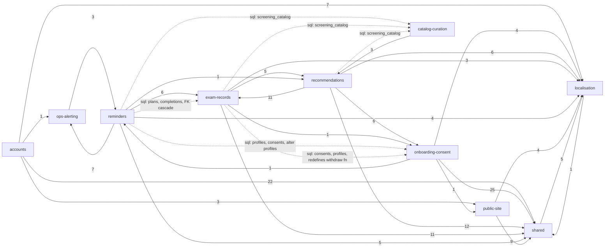

# Repo map — Dbam

## TL;DR

Dbam reminds adults in Poland about preventive screenings. A person creates an account, consents to health-data processing and fills in a profile. A rule engine then matches a curated screening catalog to that profile and shows a tiered dashboard. The person records planned or done exams, and a daily cron on Cloudflare Workers emails appointment reminders, due-screening reminders and follow-up nudges.

The **buzz** is in the dashboard core loop:

- **exam records** (recurrence rules, the screenings endpoint) is the capability later changes keep reopening;
- **recommendations** is the busiest by commits, and it is locked into a capability-level loop with exam records;
- the **reminder pipeline** is where current planning attention goes (M-02 F-12/F-13, test-plan risks #3 and #5). It reaches into three other capabilities' tables, through SQL that no import graph sees.

**Where it hurts:**

- the pipeline's SQL contracts are invisible to lint and imports, and covered only by pgTAP;
- the profile and consent module is a quiet load-bearing contract with no unit tests;
- there is **one human** in the whole history: no reviewer, no second maintainer, no visible medical owner for the catalog.

All code work stopped on 2026-10-06. Treat trends as a five-week snapshot.

Capability graph (from `evidence/3-structure.md`, runtime imports excl. the dev-only kitchen sink; solid = import edges with file-level counts, dashed = SQL coupling found by rg):

## Terrain

Buzz is rated H / M / L relative to the other capabilities. Mechanical signals were demoted before rating (see Looks hot, is not). Change = activity and trend; fix = fix share and reverts; friction = second attempts, reopenings, open items, closed-unmerged PRs; attention = planning artifacts; reach = runtime blast radius, including SQL.

| Capability         | What it does                                                                                                    | Criticality (criteria)                                                           | Change                                           | Fix                            | Friction                               | Attention | Reach                                   | Trend (W39–W41)  | Where it lives                                                                                                                                                                                            |
| ------------------ | --------------------------------------------------------------------------------------------------------------- | -------------------------------------------------------------------------------- | ------------------------------------------------ | ------------------------------ | -------------------------------------- | --------- | --------------------------------------- | ---------------- | --------------------------------------------------------------------------------------------------------------------------------------------------------------------------------------------------------- |
| **reminders**      | Daily cron: appointment reminders, due-screening reminders and follow-up nudges; email budget and retry; opt-in | high (external email integration; service-role client outside RLS; user data)    | M (7 commits, 42 changes)                        | L                              | M                                      | **H**     | **H** (SQL, low confidence)             | rising           | `src/lib/reminders/`, `src/worker.ts`, `src/lib/{email,email-retry,email-budget,schedule}.ts`, `supabase/migrations/*reminder*`, `*nudge*`                                                                |
| **exam-records**   | Record a planned or done exam, confirm a passed appointment, compute the next due date                          | high (user health data; core value)                                              | M (9 commits, 7 of them in W41)                  | L                              | **H**                                  | **H**     | **H**                                   | rising           | `src/lib/screenings/`, `src/pages/api/screenings.ts`, `src/components/recommendations/{PlanItem,DoneItem,ScreeningActions,SavedNote}.astro`, migrations `*screening_records*`, `*confirm_screening_plan*` |
| recommendations    | Rule engine (catalog × profile) and the tiered dashboard list incl. "may apply"                                 | high (core value; reads health data)                                             | **H** (16 commits; `dashboard.astro` 11 changes) | L (spillover only)             | L                                      | M         | M                                       | rising           | `src/lib/catalog/`, `src/pages/dashboard.astro`, `src/components/recommendations/`                                                                                                                        |
| onboarding-consent | Health-data consent, onboarding profile, profile edit, withdrawal that deletes data                             | high (health data created and deleted; legal gate; runtime dependency of others) | L                                                | M (#37 is the largest own fix) | M                                      | M         | **H**                                   | constant         | `src/lib/{profile,consent}.ts`, `src/pages/{onboarding,profile}.astro`, `src/pages/api/{consent,profile.ts}`, `supabase/migrations/20260927190303_onboarding_profile.sql`                                 |
| catalog-curation   | Curated JSON screening entries → schema check → generated snapshot migration; agent drafting script             | high (correctness of medical guidance; recommendations depend on it at runtime)  | L (one campaign: 61 changes in 3 commits)        | M (#45)                        | M (#42, #28 open; #87 closed unmerged) | L         | M (via table only)                      | seasonal         | `catalog/`, `scripts/catalog/`, `supabase/migrations/*screening_catalog*`                                                                                                                                 |
| accounts           | Email+password sign-up and sign-in, confirmation callback, route gating                                         | high (identity; public unauthenticated entry points)                             | L (volume is scaffold and redesign)              | L                              | L                                      | L         | L (no dependants)                       | fading           | `src/pages/api/auth/`, `src/pages/auth/`, `src/middleware.ts`, `src/lib/{password,auth-errors}.ts`                                                                                                        |
| ops-alerting       | `/api/health`, cron heartbeat, structured error logs, reminder-failure email                                    | medium (public endpoint; detects pipeline outages)                               | M                                                | L                              | M (backlog B-02 P1 open)               | M         | M (`observability.ts` has 8 dependants) | constant         | `src/lib/{observability,heartbeat,failure-alert,config-status}.ts`, `src/pages/api/health.ts`                                                                                                             |
| localisation       | PL (default) / EN catalogs, `lang` cookie, switcher                                                             | low                                                                              | mechanical                                       | —                              | —                                      | L         | mechanical fan-in                       | follows features | `src/i18n/`                                                                                                                                                                                               |
| public-site        | Landing, 404/500                                                                                                | low                                                                              | L (deleted starter files)                        | —                              | —                                      | L         | L                                       | fading           | `src/pages/{index,404,500}.astro`, `src/components/PublicHeader.astro`                                                                                                                                    |

- **Platform & infrastructure** (high: a green merge to `main` auto-runs `migrate` then `deploy` to production with no approval step). It has 33 commits and 18.8 % of code changes, but this is a deploy campaign plus CI/smoke edits made with each feature (mechanical). Hubs: `.github/workflows/ci.yml`, `scripts/smoke.mjs`, `package.json`.
- **Shared foundations** (medium): shadcn primitives, form pieces, `Layout.astro`, tokens. `src/lib/supabase.ts` has 13 runtime dependants and was the site of the only production bug (#68). `src/lib/database.types.ts` is regenerated by hand.
- **Docs & planning**: 45.6 % of all changes are prose. The real discussion lives here (`context/archive/*/plan.md`, `reviews/`), not on PRs.
- **Coverage**: 821 counted file changes (17 noise changes removed), 0 % unmapped. Of the 447 code changes, platform takes 18.8 % and shared 10.1 %, so the catch-alls are 28.9 % (under the 40 % limit). 0 of 109 graph files unmapped.
- **Folder ≠ capability**:
  - `src/components/recommendations/` holds two capabilities: five of its files are exam-record UI.
  - Every capability's schema lives in one flat `supabase/migrations/`, and a migration of one capability alters another's objects.
  - `PublicHeader.astro` (public-site) acts as a shared header for the auth and onboarding pages.
  - `src/lib/email.ts` and `src/lib/schedule.ts` sit with reminders but serve ops-alerting too.

## Real couplings

| Between                                                               | Kind                                                                                                                                                                                                                            | How we know                                                                                                                            | Mechanical?                                                                                    |
| --------------------------------------------------------------------- | ------------------------------------------------------------------------------------------------------------------------------------------------------------------------------------------------------------------------------- | -------------------------------------------------------------------------------------------------------------------------------------- | ---------------------------------------------------------------------------------------------- |
| exam-records ↔ recommendations                                        | Capability-level loop. `src/lib/screenings/{rules,due}.ts` and `api/screenings.ts` call `src/lib/catalog/recommend.ts`; `dashboard.astro` and `RecommendationItem.astro` import screenings code and exam-record components back | runtime graph (11 + 5 edges, no file cycle) **and** co-change (support 5, confidence 0.83, but a 4-commit dashboard cluster drives it) | no — hand-kept                                                                                 |
| reminders → exam-records                                              | Jobs import `screenings/rules.ts` and `due.ts`. Reminder tables cascade-delete from `screening_plans` and `screening_completions`                                                                                               | runtime graph (6) + SQL rg (low confidence). Co-change `unknown`: S-04 and S-06 were dropped by the > 6-capability cut                 | no                                                                                             |
| reminders → onboarding-consent                                        | Reminder migrations read `profiles` and `health_data_consents`, and `alter table public.profiles`                                                                                                                               | SQL rg only (low confidence)                                                                                                           | no — invisible to imports and lint                                                             |
| exam-records → onboarding-consent                                     | `20260930093108_screening_records.sql` **redefines** `withdraw_health_data_consent()`                                                                                                                                           | SQL rg only                                                                                                                            | no — schema ownership crosses capabilities                                                     |
| recommendations → onboarding-consent                                  | `src/lib/catalog/*` imports `src/lib/profile.ts` (`Profile`, `MAX_AGE`, `SEX_VALUES`, `SMOKING_STATUSES`): a domain-vocabulary contract                                                                                         | runtime graph (6)                                                                                                                      | no                                                                                             |
| reminders ↔ ops-alerting                                              | `worker.ts` → heartbeat, failure-alert, observability; those → `email.ts`, `schedule.ts`                                                                                                                                        | runtime loop + co-change (3, confidence 1.00)                                                                                          | partly: `email.ts` is infra-shaped (inference)                                                 |
| catalog-curation → recommendations                                    | `scripts/catalog/*` import `src/lib/catalog/{schema,factors}.ts`. JSON entries → snapshot migration                                                                                                                             | runtime graph (3) + co-change (3, 1.00)                                                                                                | the JSON→snapshot step is **mechanical** (generator, guarded by `npm run catalog:check` in CI) |
| migrations ↔ `src/lib/database.types.ts`                              | regeneration lockstep                                                                                                                                                                                                           | history (7 changes)                                                                                                                    | **mechanical, but unguarded**: no CI step regenerates or diffs it                              |
| `src/i18n/pl.ts` ↔ `en.ts`                                            | key catalogs                                                                                                                                                                                                                    | history hub (12 changes each)                                                                                                          | **mechanical**, guarded by `astro check`                                                       |
| `src/lib/password.ts` ↔ `supabase/config.toml` ↔ production dashboard | password policy kept in three places                                                                                                                                                                                            | CLAUDE.md rule; no tool covers it                                                                                                      | no; the third copy is outside git → `unknown`                                                  |
| `/api/health`, e-mail links → `/auth/callback`                        | external consumers                                                                                                                                                                                                              | none in repo                                                                                                                           | `unknown (external)`                                                                           |

## Risk zones

Two capabilities qualify: high criticality and high buzz in at least two independent families.

### 1. Reminder pipeline (reminders)

**Why:** it is the only code that runs unattended with the service-role key (outside RLS). It emails real people, and its correctness depends on other capabilities' schemas that no import graph or lint rule sees.

**Independent signals:**

- _Attention H_:
  - the open milestone M-02 names F-12 (research) and F-13 (refactor plan) for this pipeline;
  - test-plan risks #3 (wrong, duplicate or silent emails) and #5 (withdrawal keeps reminders going) are about it;
  - #57 (post-deploy verification) is parked;
  - two deferred follow-ups (`first-time-eligibility.md`, `cross-job-overlap.md`) are unresolved.

  Sources: `evidence/2-discussion.md:45`, `:38`, `:18`.

- _Reach H_:
  - widest outward reach (Ce 5);
  - 8 own RPCs;
  - migrations reference the tables of exam-records, onboarding-consent and catalog-curation, cascade-delete from exam-records' tables, and `alter` the `profiles` table.

  Sources: `evidence/3-structure.md:26`, `:91`; the SQL is rg-only, so confidence is low.

- _Friction M_ is supporting only: 3 agent-review REVISE/NEEDS ATTENTION flags, the most of any business capability (`evidence/2-discussion.md:18`). These are agent workflow output, not human review.

**Independence check:** attention is partly high _because_ the pipeline is the newest subsystem (S-06 and S-07 shipped in W41). Reach is structural and does not share that cause, so the two count as two families.

**Lives in:**

- `src/worker.ts`
- `src/lib/reminders/` (`due-screening.ts`, `appointment.ts`, `follow-up-nudge.ts`, `candidates.ts`, `chain.ts`, `admin-client.ts`)
- `src/lib/email.ts`
- `supabase/migrations/20260930125726_appointment_reminders.sql`
- `supabase/migrations/20261006155313_due_screening_reminders.sql`
- `supabase/migrations/20261006204148_follow_up_nudges.sql`
- pgTAP suites `supabase/tests/database/{appointment_reminders,due_screening_reminders,follow_up_nudges}.test.sql`

### 2. Exam records: recurrence rules and the dashboard seam (exam-records, with its recommendations loop)

**Why:** this is where user health records are written and the next due date is computed. The next-due rules are the highest-reach business file, consumed by recommendations and by the reminder cron. Later changes keep coming back here.

**Independent signals:**

- _Friction H_. Reopened by three later changes:
  - the redirect slug leak found by error-tracking → F-09 #85;
  - recurrence tests deferred → F-08 #79;
  - backlog B-04 "a plan with a missing catalog entry hides its screening" is still open, with follow-up `missing-entry-plan.md`.

  Source: `evidence/2-discussion.md:36`, `:38`.

- _Reach H_:
  - `src/lib/screenings/rules.ts` has 9 dependants, the highest of any business file;
  - the capability-level loop with recommendations;
  - reminder tables cascade from `screening_plans` and `screening_completions`;
  - `api/screenings.ts` is the fattest endpoint, importing 5 capabilities, with a dynamic `.from(table)`.

  Sources: `evidence/3-structure.md:143`, `:100`, `:88`.

- _Attention H_: 4 change folders, prose churn 24, and test-plan risks #1, #4 and #6 (`evidence/2-discussion.md:15`, `:46`).

**Independence check:** attention and change share a cause, the W41 build-out of S-05, F-08 and F-09, so they are counted once. Friction (reopenings found by _other_ changes) and reach are independent of that cause.

**Lives in:**

- `src/lib/screenings/{rules,due}.ts`
- `src/pages/api/screenings.ts`
- `src/lib/catalog/recommend.ts` (the other half of the loop)
- `src/pages/dashboard.astro`
- `src/components/recommendations/{PlanItem,DoneItem}.astro`
- `supabase/migrations/20260930093108_screening_records.sql`
- `supabase/migrations/20261005173653_confirm_screening_plan.sql`

### Watch

These narrowly miss the bar. Each has one high family plus medium ones.

- **onboarding-consent: the withdrawal and profile contract.**
  - _Reach H_: `src/lib/profile.ts` has 8 dependants and is the vocabulary of the rule engine (`evidence/3-structure.md:144`). `withdraw_health_data_consent()` is owned here but redefined by the exam-records migration (`evidence/3-structure.md:119`).
  - Friction and fix are one shared cause, the #37 hardening round (+519/−73, `evidence/2-discussion.md:32`), so they count once, as medium.
  - `consent.ts`, `profile.ts` and `middleware.ts` have 0 unit tests (`evidence/3-structure.md:129`).
  - Test-plan risk #5 links it to reminders.
- **catalog-curation: content correctness.**
  - The buzz is medium only: #45 hardening, issues #42 and #28 open, #87 a closed vendor PR at the drafting script (`evidence/2-discussion.md:20`, `:37`).
  - It sits here because of the people unknown: no visible medical or domain owner signs off entries (`evidence/4-people.md:64`).

### Looks hot, is not

- **platform**: 33 commits, `ci.yml` 15 changes, 3 agent-review flags. These are the W39 deploy campaign and CI iteration (rules 4, 5). It stays high-criticality, but the buzz is mechanical.
- **localisation**: 13/13 commits are cross-cutting, `i18n/index.ts` has 34 dependants and `pl.ts`/`en.ts` 12 changes each. This is lockstep guarded by the type check, plus config-as-code fan-in (rules 2, 3).
- **catalog-curation change volume**: 61 changes are the first content batch from 3 commits, not churn.
- **accounts change volume**: 48 changes come from the scaffold, the S-01 translations and the redesign. Its only own feature commit is #14.
- **public-site**: its top 3 files are deleted starter components (rule 11). Its 25 % fix share is spillover from #37 (rule 12).
- **Per-capability fix shares** (11–33 %): there are only 6 fix commits, 4 of them close-out review rounds. One commit drives each share.
- **shadcn and `database.types.ts` fan-in**: design system and generated types, type-only edges (rules 2, 7, 9).
- **The 9-node capability cycle** appears only through `src/pages/dev/kitchen-sink.astro`, which is dev-only.
- **PR #48 at 18k lines**: 16.9k of them are the generated `worker-configuration.d.ts`.
- **docs at 45.6 % of changes**: prose (rule 8).

## Whom to ask

**Baseline: one human in the whole window.** That is Amadeusz Kozłowski (forge `amakoz`), under two git identities. They authored and merged 100 % of commits and PRs in every capability. 56/61 commits are agent co-authored, and agents are not people. Concentration is therefore the baseline, not a finding (`evidence/4-people.md`).

| Zone                      | Ask                                      | Read first (in place of a second opinion)                                                                                                                                                            |
| ------------------------- | ---------------------------------------- | ---------------------------------------------------------------------------------------------------------------------------------------------------------------------------------------------------- |
| Reminder pipeline         | the owner (only person)                  | `context/archive/2026-09-29-reminder-dispatch-path/`, `2026-09-30-appointment-reminder/`, `2026-10-06-due-screening-reminder/`, `2026-10-06-follow-up-nudges/` (PRs #48, #53, #66, #84, #86)         |
| Exam records              | the owner (only person)                  | `context/archive/2026-09-30-record-appointment-date/`, `2026-10-05-confirm-exam-and-recurrence/`, `2026-10-06-recurrence-unit-tests/`, `2026-10-06-redirect-query-privacy/` (PRs #59, #75, #79, #85) |
| Watch: onboarding-consent | the owner                                | `context/archive/2026-09-27-onboarding-profile/` (PRs #30, #35, #37)                                                                                                                                 |
| Watch: catalog-curation   | the owner; **medical sign-off: unknown** | `context/archive/2026-09-28-screening-catalog-v1/`, `catalog/README.md` (PRs #44, #45, #50; rejected outside PR #87)                                                                                 |

The people signal is thin by nature here. There is no reviewer, no second maintainer, no CODEOWNERS and no PR assignees. These are stated as unknowns in Limitations, not filled with guessed ownership.

## First day

1. `src/pages/dashboard.astro`: the product in one page. It composes recommendations, exam records and consent state (Ce 21).
2. `src/lib/catalog/recommend.ts`: the rule engine (catalog × profile → tier and interval). Read it with `src/lib/profile.ts`, which holds the profile vocabulary it depends on.
3. `src/lib/screenings/rules.ts`: the next-due and recurrence rules, the highest-reach business file. Its tests are `src/lib/screenings/rules.test.ts` and `due.test.ts`.
4. `src/pages/api/screenings.ts`: the write path for exam records, and the fattest endpoint (5 capabilities, dynamic table).
5. `src/worker.ts` → `src/lib/reminders/due-screening.ts`: the cron dispatcher and one complete reminder job (claim → send → mark).
6. `supabase/migrations/20261006155313_due_screening_reminders.sql`: the claim and mark RPCs, and how the pipeline reaches into plans, completions, profiles and the catalog.
7. `supabase/migrations/20260927190303_onboarding_profile.sql` with `src/lib/consent.ts`: the consent model and the withdrawal function, which other migrations redefine.
8. `src/middleware.ts`: route protection (`PROTECTED_ROUTES`) and locale. This is where access is decided for every page.

## Limitations

- **Window:** about 5 weeks (2026-09-24 to 2026-10-27), 61 squash-merged commits and 3 active weeks (W39–W41). There were zero commits in W42–W43, and W44 is docs only. Trends rest on 0–8 commits per cell.
- **Sources:** git plus `gh` (58 PRs, 31 issues, all comments, read-only). Issues are mapped to capabilities by title only (inference).
- **Graph coverage:**
  - TS/TSX/.astro: compiler API, medium-high confidence.
  - SQL: rg only, low confidence. RLS policy bodies, function bodies, triggers and column-level dependencies are `unknown`.
  - Catalog JSON and platform config (wrangler cron → worker, CI → scripts, `astro:env`): `unknown`.
  - Astro template-level usage (slots, hydration) is not modelled.
- **Capability coverage:** 0 % unmapped. The catch-alls are 28.9 % of code changes.
- **Agents:** all four evidence agents completed, with no gaps.
- **Co-change blind spot:** the feature commits of reminders (S-04, S-06), onboarding-consent (both S-01 commits) and F-07 touch more than 6 capabilities. They are dropped from co-change, so their coupling is shown only by the import and SQL graphs.
- **What the map does NOT say:**
  - nothing about runtime behaviour in production: error content is out of scope;
  - nothing about the quality of the medical content;
  - nothing about the status of deferred follow-ups and backlog items, which were not read.
- **Unknowns worth a focused investigation:**
  1. **People (the main gap):**
     - no second maintainer;
     - no human reviewer (0 reviews on 58 PRs);
     - no visible domain or medical owner for catalog entries (the "owner review gate" in #50 does not say who signs off);
     - no formal ownership;
     - the meaning of the second, work-domain git identity;
     - whether the owner is still active on code (last code commit 2026-10-06).
  2. **Reminder SQL contracts (input for F-12):** what a change to `profiles`, `health_data_consents`, `screening_plans` or `screening_completions` breaks in the 8 reminder RPCs. Today only pgTAP guards it. A `pg_depend` dump or `supabase db lint` against local Supabase would close this.
  3. **Withdrawal ownership:** `withdraw_health_data_consent()` is redefined in the exam-records migration. Do reminders tables get cleared on withdrawal (test-plan risk #5)?
  4. **`database.types.ts` staleness:** no CI check. Verifying needs `npm run db:types` against local Supabase, which was not run.
  5. **Password policy drift:** the third copy (production dashboard) is outside git.
  6. **The dynamic `.from(table)` in `src/pages/api/screenings.ts`**: the target table is not statically known.
  7. **External consumers:** who monitors `/api/health`; the email links back to `/auth/*`.
  8. **Off-repo discussion:** chat and the gitignored orchestrator notes.
  9. **Tracker drift:** #24 (S-06) and #25 (S-07) are still OPEN although shipped, and `context/changes/dashboard-tier-polish/` is not archived.
- **Tools worth adding** (not installed by this run):
  - **dependency-cruiser**, to encode more boundaries next to the single ESLint rule (only `src/worker.ts` may import `src/lib/reminders`, and it holds), e.g. `src/lib/catalog` ↛ `src/lib/screenings`;
  - **madge**, for quick cycle checks.
